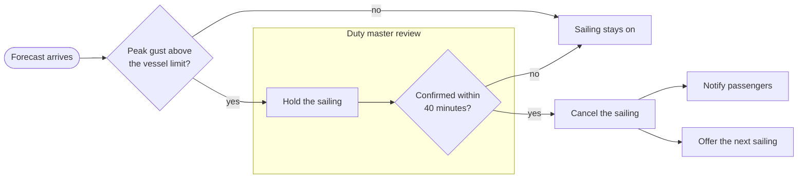

A sailing is held when the forecast gust passes the vessel's limit. The duty master then has 40 minutes to confirm or release the hold.

## When a sailing is held

Each vessel has a gust limit in knots, stored as `gust_limit_knots`. A new forecast arrives every hour. If its peak gust for the crossing is above the limit, the sailing is held and passengers see a notice that says the sailing is under review.

A gust that is more than 5 knots above the limit cancels the sailing at once, with no review.

| Vessel | Route | Gust limit | Review time | Sailings a day |
| --- | --- | ---: | ---: | ---: |
| MV Kittiwake | Port Ellery to Skerry Island | 34 kn | 40 min | 12 |
| MV Sandpiper | Port Ellery to Skerry Island | 28 kn | 40 min | 8 |
| MV Curlew | Port Ellery to Tarn Quay, freight | 38 kn | 60 min | 4 |

## The decision in one picture



Figure 1. What happens to one sailing when a forecast arrives.

## The rule in code

```rust
/// Decide what happens to one sailing when a new forecast arrives.
pub fn decide(sailing: &Sailing, forecast: &Forecast) -> Decision {
    let limit = sailing.vessel.gust_limit_knots;
    match forecast.peak_gust_knots {
        gust if gust <= limit => Decision::Sail,
        gust if gust <= limit + 5 => Decision::Hold {
            review_by: forecast.issued_at + Duration::minutes(40),
        },
        _ => Decision::Cancel { reason: "gust above the vessel limit" },
    }
}
```

## What passengers see

- A held sailing shows "Under review" on the departures board and in the app.
- A cancelled sailing offers a seat on the next sailing with space, at no charge.
